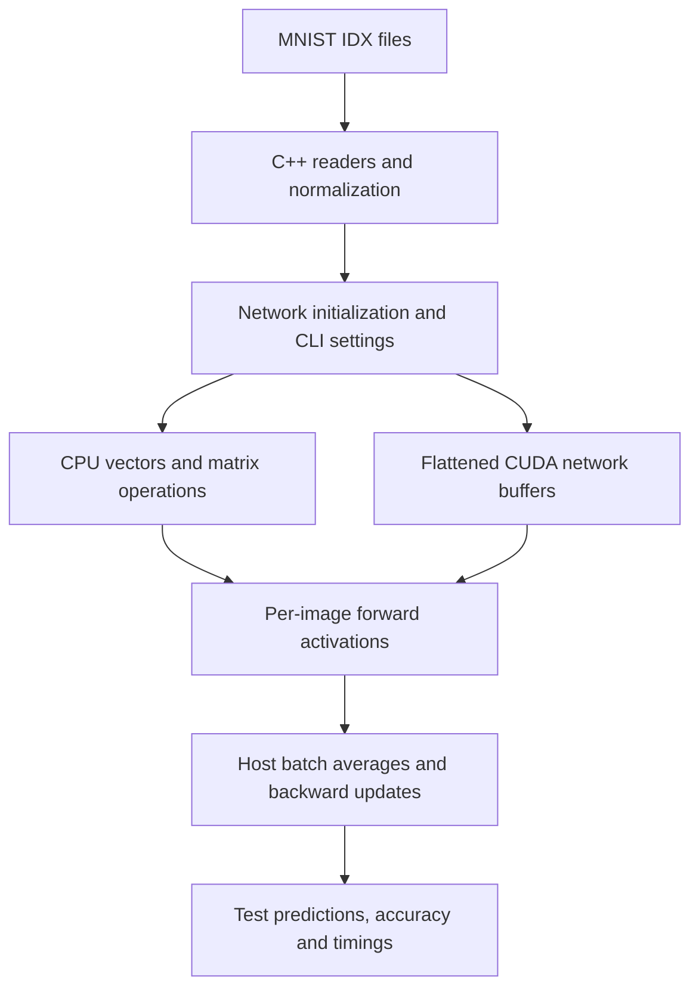

# Image Recognition

An educational neural network for handwritten digit recognition, implemented in C++17 and CUDA with separate CPU and GPU training/evaluation paths. Created with the help of 3Blue1Brown’s neural network explanation playlist.

The program reads MNIST’s 60,000 training images and labels and 10,000 test images and labels. It normalizes pixels from 0–255 to 0–1, initializes a dense network, trains in batches, and measures classification accuracy on test images. Training makes one sequential pass over the requested examples.

## Implementation

- Network: 784 inputs for standard 28×28 MNIST images, hidden layers of 512 and 256 neurons, and 10 outputs.
- Sigmoid forward activations, squared-error loss reporting, and experimental custom backpropagation.
- CPU matrix-vector operations and CUDA kernels for forward propagation, deltas, and accumulated weight/bias updates.
- Configurable learning rate, batch size, seed, train/test limits, and logging.
- Independent CPU and GPU runs can start from copies of the same initialized network.



GPU weights remain on the device during training, but batch coordination and activation storage involve host/device transfers. Images are forwarded individually within each batch.

## Build and dataset setup

The current build requires CMake, a C++17 toolchain, the CUDA toolkit, and Boost.Program_options (CMake requests Boost 1.65 or newer), including for CPU execution. CMake hard-codes CUDA architecture `89` and adds `-mfma`; review these settings for your compiler and hardware. The CUDA error logger also uses `execinfo.h`.

MNIST was originally obtained from http://yann.lecun.com/exdb/mnist/; the original README notes that source is no longer available. Its suggested alternative is https://github.com/cvdfoundation/mnist. Obtain and decompress the four IDX files and place them at these exact paths (rename downloaded files if necessary):

```text
tmp/train-images.idx3-ubyte
tmp/train-labels.idx1-ubyte
tmp/t10k-images.idx3-ubyte
tmp/t10k-labels.idx1-ubyte
```

From the repository root:

```bash
cmake -B build -S .
cmake --build build
./build/ImageRecognition --cpu --seed 50 --batch-size 1 --train 10000 --test 1000
./build/ImageRecognition --gpu --seed 50 --batch-size 1 --train 10000 --test 1000
```

Commands are checked against source and build declarations; they have not been executed as part of this documentation review.

## Usage

Choose `--cpu`, `--gpu`, or both. With neither flag the program loads data and initializes a network but performs no training or evaluation. Both flags run separate CPU and GPU experiments from the same initial parameters.

| Option                     | Default             | Meaning                                                         |
| -------------------------- | ------------------- | --------------------------------------------------------------- |
| `--cpu`, `--gpu`           | Both off            | Select execution paths                                          |
| `--train`                  | All training images | Number of training examples, clamped to available images        |
| `--test`                   | All test images     | Number of test examples, clamped to available images            |
| `--batch-size`, `-b`       | 1                   | Examples per parameter update; use a positive value             |
| `--learning-rate`          | 0.05                | Update learning rate                                            |
| `--seed`, `-s`             | 0                   | Initialization seed; zero requests a random seed                |
| `--log`, `-l`              | NOTICE              | FATAL, ERROR, WARNING, NOTICE, INFO, DEBUG, or TRACE            |
| `--help`, `-h`             | Off                 | Prints options, but currently continues into dataset loading    |

`--config` is parsed but is not loaded by the main application; use `--log` to set its verbosity. A final partial training batch is processed.

Additional comparisons and debugging examples:

```bash
./build/ImageRecognition --cpu --seed 50 --batch-size 2 --train 10000 --test 1000
./build/ImageRecognition --gpu --seed 50 --batch-size 2 --train 10000 --test 1000
./build/ImageRecognition --cpu --gpu --seed 50 --batch-size 2 --train 2 --test 1 -l DEBUG
# Training-only diagnostic: --test 0 skips testing, but final accuracy is not meaningful.
./build/ImageRecognition --gpu --seed 50 --batch-size 2 --train 2 --test 0
```

The old `ImageRecognitionTest` command and `-n` argument are obsolete: neither is declared by the current build/parser.

## Diagnostic programs

```bash
./build/MatrixMult
./build/Atomic
./build/CudaInspection
```

`MatrixMult` prints control, CPU, and GPU multiplication results and attempts to read logging settings from `cfg/config.ini`; `cfg/example.config.ini` provides an example. `Atomic` experiments with atomic addition. `CudaInspection` explores thread indexing. These are manual experiments without automated assertions; the inspection program currently contains an uninitialized string buffer and should be corrected before use.

## Results and status

The root README records a best test accuracy of **90.17%** for both CPU and GPU, using learning rate 0.14 and batch size 3. It records these durations (the code measures seconds):

| Path | Training | Testing |
| ---  | ---:     | ---:    |
| GPU  | 51.12    | 28.09   |
| CPU  | 625.72   | 42.56   |

These are historical developer-reported measurements, without retained raw logs, complete run settings, or hardware details. Timers include logging and deliberate sleeps, and differ in allocation/transfer scope; the values are not a controlled performance comparison. A source comment lists learning rate 1.4 for the same accuracy, so the exact historical setup needs confirmation.

The original progress notes document completed data loading, normalization, initialization, forward propagation, biases, loss calculation, training, testing, GPU execution, seeded initialization, memory-lifetime fixes, reorganization, and batching. Early learning-rate experiments reported 60–80% accuracy. GPU debugging corrected a delta-buffer pointer offset and later replaced stale last-image activations with batch averages in backpropagation.

Source development stopped in October 2024; October 2026 changes update documentation. Speed optimization remains unfinished. Mathematical correctness also needs further work: hidden-layer backward derivatives use ReLU despite sigmoid forward activations, output derivatives apply sigmoid again to activated values, and batch deltas use averaged activations/targets rather than per-example gradients. CPU/GPU agreement does not resolve these shared issues. There is no model checkpoint workflow or automated end-to-end regression suite in the current repository.
