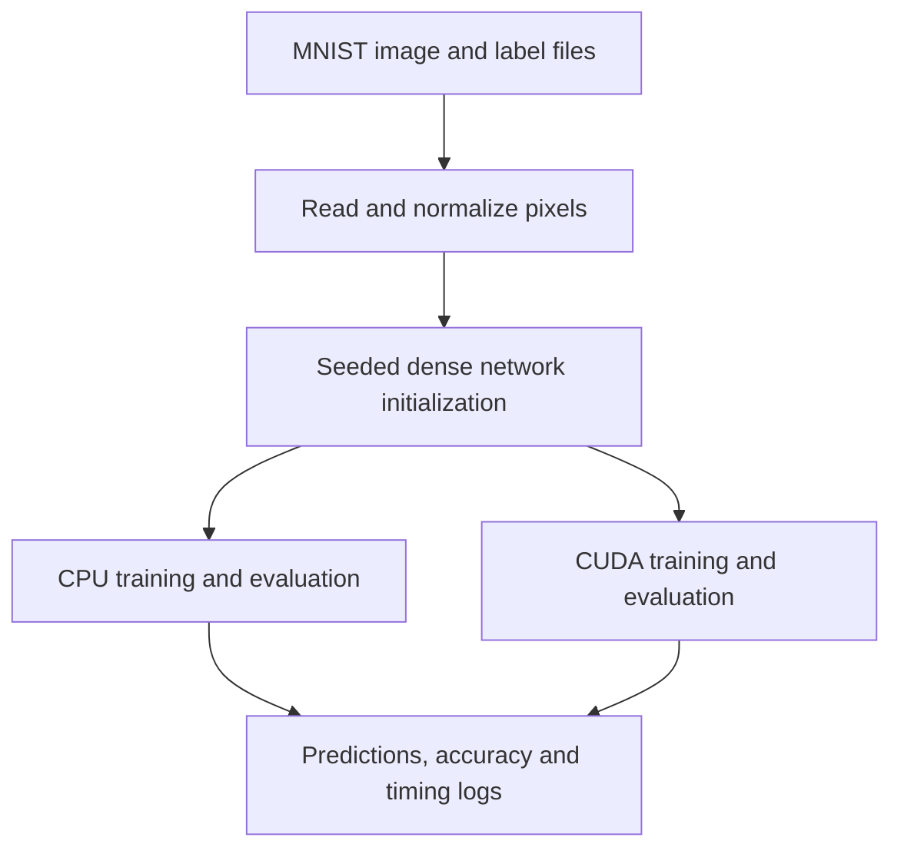

# Image Recognition

## Overview

An educational handwritten digit classifier built to explore neural networks, C++, and CUDA, inspired by 3Blue1Brown’s neural network playlist. It reads MNIST images and labels, normalizes pixels, trains a dense network, and evaluates digit predictions through separate CPU and GPU implementations.

## My Contributions

Implemented dataset readers, network initialization, forward propagation, backpropagation, training and evaluation loops, and command-line controls. Developed CUDA kernels for matrix-vector multiplication, activations, error propagation, and accumulated parameter updates, alongside a CPU implementation for comparison. Added diagnostic logging, matrix multiplication examples, and CUDA experiments.

## Architecture

The current network has 784 inputs for standard MNIST images, hidden layers of 512 and 256 neurons, and 10 digit outputs. Both paths use sigmoid forward activations. CUDA stores flattened weights on the device while the host coordinates batches and retains activations.

## Technical Challenges

Debugging CPU/GPU differences required tracing intermediate activations and error terms. An August 2024 correction replaced an incorrect delta-buffer offset with a separate copied buffer. A September correction explicitly transferred batch-average activations to the GPU before backpropagation, replacing stale activations from the last image. Training also evolved from individual examples to accumulated batch updates.

## Results and Current State

The root README records 90.17% testing accuracy for both implementations, with batch size 3 and learning rate 0.14. These are historical developer-reported results, not independently reproduced benchmarks. The repository includes diagnostic programs but no automated numerical regression suite. The training mathematics remains experimental: backward derivatives do not consistently match the forward activations, and batch deltas are calculated from averaged activations and targets.

## Development History

Observed development ran from July 28 through October 5, 2024: data loading and forward propagation first, CPU backpropagation and CUDA training in August, then batching and parity debugging in September. October changes enlarged the network and changed hidden-layer derivatives. The only subsequent observed activity consists of README updates on October 13, 2026. The implementation is inactive.
